<picture>
  <source media="(prefers-color-scheme: dark)" srcset="assets/banner-dark.svg">
  
</picture>

  
  
  
  

  I build backend systems, data pipelines and LLM tools that find the signal in messy data. 
  Final-year B.Tech, Electrical Engineering at NSUT · CGPA 8.73 · merit scholarship, top 5%

 

### 🛤️ Where I've worked

| | Role | What I did |
|---|---|---|
| **Kalki** Jul 2026 to now | Software Engineering Intern | A polling and prediction app. Twelve AI agents draft the day's polls, humans review every one, and the agents are scored against what actually happened. |
| **Innovaccer** Jan to Jul 2026 | Software Engineering Intern | Enterprise RFPs, automated: a PDF goes in, a grounded draft comes out (OCR, pgvector retrieval, guardrails, DOCX export). **3 production products in under 4 months.** |
| **CRIS** May to Jul 2025 | Machine Learning Intern | Forecast how long freight takes to load and unload. **430K+ records, about 2.7 RMSE.** |

### 🛠️ Things I've built

<table>
  <tr>
    <td width="50%" valign="top">
      <h4><a href="https://github.com/Raman-Cz/VectorDB">VectorDB</a></h4>
      A vector database engine, written from scratch in C++. Exact search, IVF, product quantization and IVFPQ with a cache-aware memory layout.  
      <b>5.8x faster than exact search at 92% recall@10.</b> 
      Next up: write-ahead-log crash recovery.
    </td>
    <td width="50%" valign="top">
      <h4><a href="https://github.com/Raman-Cz/interview-platform">Intervue</a></h4>
      An interview platform with real-time video and a collaborative code editor.  
      Next.js · TypeScript
    </td>
  </tr>
  <tr>
    <td width="50%" valign="top">
      <h4><a href="https://github.com/Raman-Cz/Light-Years">Light-Years</a></h4>
      A 2D space jet fighter game, built in C++.  
      C++
    </td>
    <td width="50%" valign="top">
      <h4><a href="https://github.com/Raman-Cz/My-portfolio-website">Portfolio</a></h4>
      My site, plus a cinematic scroll edition with GSAP and three.js.  
      Next.js · GSAP · three.js
    </td>
  </tr>
</table>

### 🧰 Tools I reach for

  

Also: LLM agents and tool use, RAG, pgvector, Claude and OpenAI APIs, BullMQ, Celery, LightGBM, Sentry.
